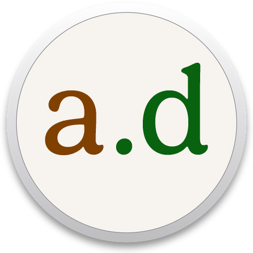
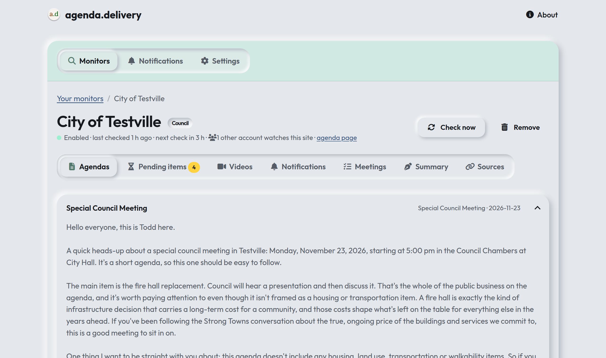
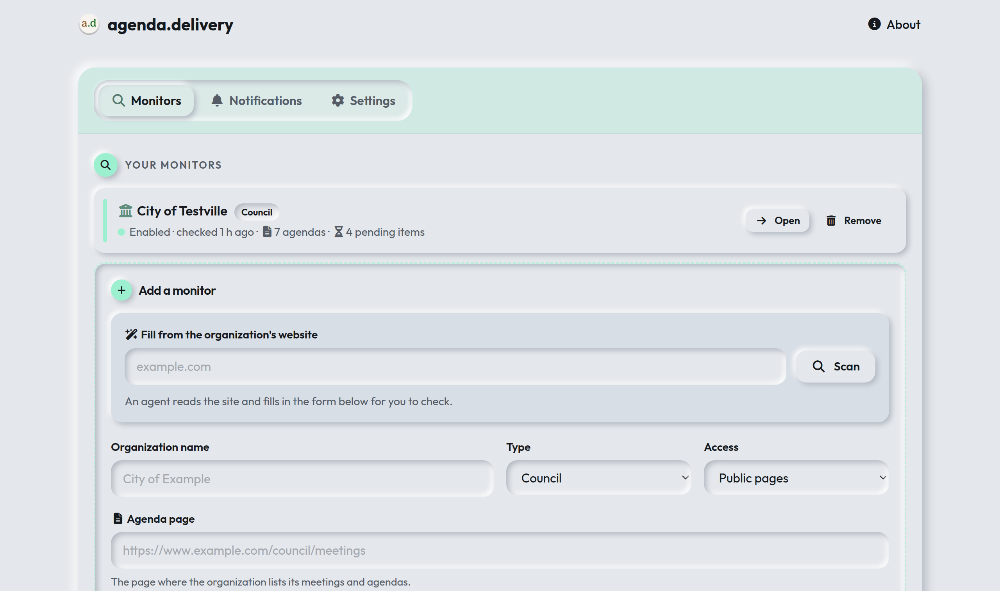
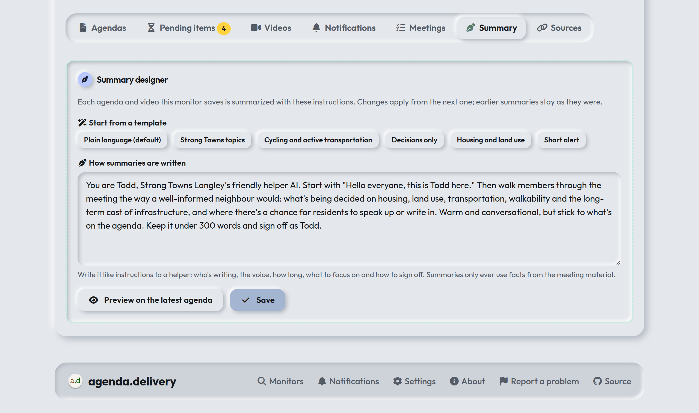
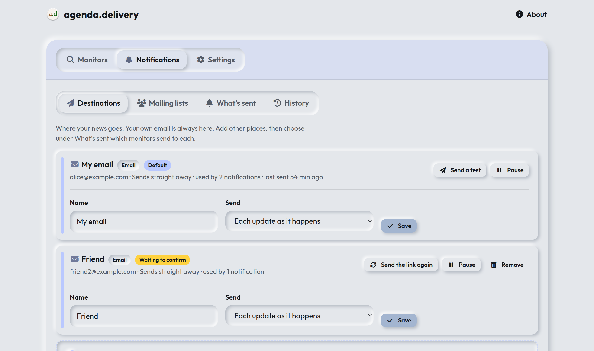
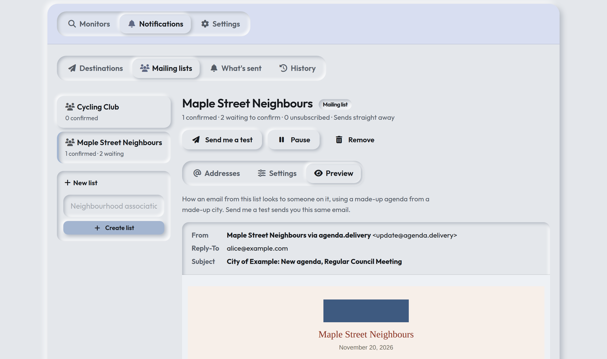

<p align="center"></p>

<h1 align="center">agenda.delivery</h1>

<p align="center"><b>Know what's on the agenda before it's decided.</b><br>agenda.delivery watches the public meetings of councils, school boards and other organizations. Each organization you add gets its own AI agent, which reads the agendas and meeting video transcripts as they're posted, writes plain language summaries in the style you choose, keeps track of the items still working their way through, and sends the news to your email, a mailing list, a Discord channel, a WhatsApp group, your phone through Pushover, or a webhook.</p>

<p align="center"><a href="https://agenda.delivery"><b>Use it at agenda.delivery</b></a></p>

<p align="center"></p>

An account is free. New accounts join with a sign-up code, or by filling in a short registration that an admin approves.

## Background

agenda.delivery started with [Todd](https://strongtownslangley.org/todd/), an AI agent I created for Strong Towns Langley, whose tasks include generating summaries of the Township of Langley and City of Langley council meetings so our members know what's coming up and when there's a chance to speak. This site opens the same idea up to anyone, from a resident keeping an eye on their own community to a group that needs to know what's being decided at council, a school board or any other organization that posts its meetings.

It's a small project running on a single $20/month server and a $20/month Ollama Cloud plan, so it's built to be as light as possible. There's no framework and no container stack, just PHP, one SQLite database and a lightweight AI agent for each organization, which keeps the cost of adding another organization close to nothing.

## Features

- **Monitors.** A monitor is one organization you follow. Paste its website and an AI agent fills in its name, type, agenda page and meeting videos for you, or you can fill those in yourself. Each monitor has its own agent, and if someone else already follows the same page, yours starts with what theirs has learned about the site.

<p align="center"></p>

- **Meeting types.** While setting up, the agent works out which kinds of meetings the organization holds (regular council, public hearings, committees and so on), and you choose which ones to follow.
- **Summaries your way.** The summary designer starts from a template (plain language, Strong Towns topics, cycling and active transportation, decisions only, housing and land use, or a short alert) that you can change however you like, and previews it on the latest agenda. When an item comes back to council, the summary says where it stood.

<p align="center"></p>

- **Agendas and videos.** The agent finds each new agenda and writes its summary. Add a video page or YouTube channel and it summarizes each meeting from its captions, with members' names corrected. A new monitor's first check saves what's already posted without sending it, so you only hear about meetings that appear after you add it.
- **Pending items.** Bylaws between readings, motions waiting on a staff report, deferred items and scheduled public hearings stay listed on the monitor's page until they're settled.
- **Notifications.** Your own email address is always a destination, and a new monitor sends its summaries there. Add other email addresses, mailing lists, Discord webhooks, a WhatsApp group, Pushover or a JSON webhook, then choose for each monitor which destinations get its news and what each one gets, whether that's the summary, just the link, the lines that match your keywords, or the answer to your own question. Email can arrive as each update happens, or gathered into a daily or weekly roundup that's only sent when there's news. Any destination can be paused, and a history shows what was sent, what stayed quiet and what failed.

<p align="center"></p>

- **Mailing lists.** Name a list, paste or import its addresses, and use it as a destination. Each address gets a confirmation link and receives nothing until its owner uses that link. Every email has an unsubscribe link that works without signing in, and an address that unsubscribes can only be added back by its owner. A list can have opening and closing text, and replies can come to you. Its Preview tab shows a sample email as the people on it will see it, and Send me a test sends you that sample.

<p align="center"></p>

- **Your own look.** A mailing list sends as agenda.delivery, or as custom with an organization name, logo and colours, using either the ones in your Settings or its own. Colours come from 5 presets or your own picks, with a live preview. Logos are PNG, JPEG or WebP, up to 500 KB and 1200 pixels across. Mail to your own address always uses the agenda.delivery design.
- **WhatsApp.** Link a WhatsApp account by scanning a code on the Notifications page, as you would for WhatsApp Web, then choose one of its groups to send to. It only ever sends to groups. If the link drops for more than 10 minutes, you get an email. It links as an unofficial device, which WhatsApp may restrict, so a spare number is safest.
- **Pushover.** Updates go to your phone through the Pushover app. Once the site's Pushover app token is set in the config you only need your user key, and until then you add an app token of your own as well.
- **Sign-in** with Google or a code sent by email. Someone new goes straight to joining, with a sign-up code or a short registration, and the sign-in link in the email that lets them in confirms their address. A Report a problem page is open to everyone, including people who were turned away.
- **Admin panel** with sign-up requests to approve, sign-up codes, problem reports, users, every agent's state, sites and their repairs, runs, the tool queue, AI token usage and failed deliveries.

## What works

- Public agenda pages, including pages that only render with scripts.
- YouTube and any other video site yt-dlp can read captions from.

### Not yet

- Organizations whose agendas are behind a login. The form lists them as coming soon.
- Videos with no captions, since transcribing audio would be too heavy for the server.

## How it works

The site is plain PHP with the Opalite stylesheet and a single SQLite database in WAL mode, served by php-fpm behind Caddy.

Every monitor has an agent: a [NullClaw](https://github.com/nullclaw/nullclaw) gateway with its own home folder at `/var/lib/agenda/agents/m-<id>`, holding its config, its instructions (`src/agent_instructions.md`), its memory and its workspace. Each gateway listens on its own loopback port, takes instructions only with a token the service holds, and uses about 3 MB of memory while it waits.

Monitors of the same page share a site record: how the site is laid out, its meeting types, its members' names and a cache of the pages read. When a site changes, the first agent to notice repairs the notes, and the others watching it run again with the fix.

`agenda-delivery.service` runs all of them. It's a system service running as the unprivileged `agenda` user (no Docker), written in Python with only the standard library (`bin/agenda-delivery-service.py`). It:

- keeps a gateway running for every monitor, checks each one's health every 15 seconds and restarts any that stop, with a growing pause if one keeps failing
- runs each agent every six hours at its own offset within the hour, or straight away when someone presses Check now, at most 2 at a time, and records every run in `agent_run`
- runs every executable an agent needs, Chrome (2 at a time, in a virtual display so bot checks let it through), `pdftotext` and `yt-dlp`, with time limits, and records each in `job`
- keeps a WhatsApp bridge (`whatsapp/bridge.mjs`, a small Node program using Baileys) running for each WhatsApp destination, records whether it's linked, and unlinks it and deletes its session when the destination is removed
- runs `bin/tick.php` every minute and after each run, which imports each agent's token use into `ai_usage`, sends waiting notifications (retrying a failed one for up to a day), sends the daily and weekly digests at `digest_hour` by the clock set in `timezone`, and emails the owner of a WhatsApp link that has dropped

The website and `adtool` reach the service through an HTTP API on the Unix socket `/run/agenda-delivery/service.sock`: `GET /health`, `GET /agents`, `GET /agents/<key>/log`, `POST /agents/<key>/run`, `sync`, `pause` and `resume`, `DELETE /agents/<key>`, `GET /jobs` and `POST /exec`. The database holds what each agent should be doing, so if the service is down nothing is lost, and it picks up where things stand when it starts.

The agent can only run one shell command, `adtool`, which reads pages (`fetch` over plain HTTP, `render` through Chrome), PDFs, video lists and captions, and saves agendas, videos, pending items and the site's notes back to the database, scoped to its own monitor. It works out each site from the page itself, with no code written for any particular website.

## Install

On Ubuntu 22.04 or newer, as root, from a checkout of this repository:

```sh
sh deploy/install.sh
```

This installs Caddy, PHP, poppler, Chrome, NullClaw (checked against the release this was tested with), a small Python venv with undetected-chromedriver and yt-dlp, and, where Node is installed, the WhatsApp bridge's packages. It creates the `agenda` user, copies the code to `/opt/agenda` and starts `agenda-delivery.service`.

Then fill in `/opt/agenda/config.php`: the Ollama Cloud key, admin emails, and optionally the Google sign-in client, a Pushover app token, `timezone` and `digest_hour`. `config.example.php` lists every setting. Add `deploy/Caddyfile` to your Caddy config. Mail is sent through the host's `sendmail`, so the server needs a working Postfix or similar.

Google sign-in needs an OAuth client with the redirect URI `https://agenda.delivery/api/auth/callback/google`. Without one, sign-in by email code still works.

### Upgrading

A new install makes every table itself. A database from an earlier version needs the files in `deploy/migrations`, each applied once in date order while the service is stopped and before the new code is installed: `sqlite3 /var/lib/agenda/agenda.db < deploy/migrations/<file>.sql`. Run the one ending in `.sh` with `sh` instead.

## Development

```sh
php -S localhost:8000 -t public public/index.php
php tests/check.php
```

Set `data_dir` in `config.php` to a local folder, and `mail_capture` to a file to collect outgoing mail there. The agents and the service need Linux. `testcouncil/testcouncil.py` serves made-up councils whose meetings and layout you can change, for trying agents against.

## AI use disclosure

agenda.delivery was built using [Claude Code](https://claude.com/claude-code) with Claude Opus 5.5 and Claude Fable 5.2.

## Licence

GPL-3.0. See [LICENSE](LICENSE).
